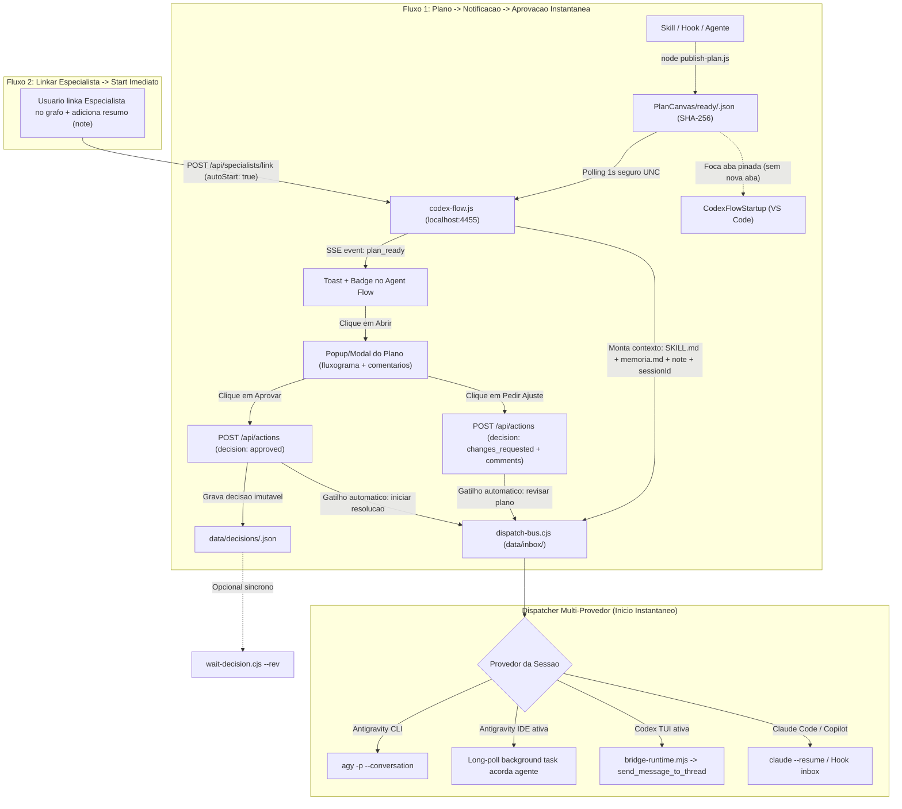

# Plano — Gatilhos Automáticos (Especialistas + Aprovação Instantânea) e Popup de Planos no Agent Flow

**Data:** 2026-11-19 (Revisão 2)  
**Escopo:** `Aplicativos/CodexFlow/` (servidor + visualizador) e `Repositorio/Infraestrutura/CodexFlowStartup/` (extensão VS Code), integrando com `Aplicativos/Integracoes/PlanCanvas/`.  
**Skill aplicada:** `flow-dev`

---

## 1. Objetivo
Tornar o **Agent Flow** (`http://localhost:4455`) um painel de **acionamento e validação instantânea** — **sem barra de chat manual** — focado em 3 fluxos automáticos:
1. **Especialista linkado → Start imediato:** ao linkar um especialista a uma sessão/nó (mesmo após o chat já ter começado) com seu resumo/nota (`note`), o sistema dispara automaticamente o agente na conversa para ler sua skill (`SKILL.md` + `memoria.md`), o resumo informado e o contexto atual, identificando onde atuar.
2. **Plano aprovado no site → Início instantâneo:** ao clicar em **Aprovar** no popup do plano dentro do Agent Flow, a decisão é persistida e dispara imediatamente a execução/resolução do plano na conversa ativa, sem precisar digitar nada no chat.
3. **Planos de skills/hooks no próprio Agent Flow:** sinais de `publish-plan.js` aparecem no Agent Flow como **notificação (toast + badge)** e abrem em **popup/modal** sobre o grafo (em vez de nova aba separada no VS Code).

---

## 2. Como Funciona o Disparo Automático (Sem Barra de Chat)
O servidor local (`codex-flow.js`) usa um **Dispatcher Multi-Provedor** acionado apenas por eventos de ação da UI (linkar especialista / aprovar plano / enviar comentários do plano), nunca por `terminal.sendText` ou colagem simulada:

- **Antigravity (`agy` CLI):** disparo programático com retomada de conversa via `agy -p "<gatilho>" --conversation <SESSION_ID> --output-format json` (ou processo residente `stream-json`). Para sessão já aberta na IDE, grava evento em `data/inbox/<uuid>.json` e acorda o listener em background (sem concorrência de escrita).
- **Codex:** reaproveita a ponte nativa comprovada (`PlanCanvas/bridge-runtime.mjs` → `mcp__codex_tui__send_message_to_thread`) via fila `data/inbox/`, marcando `.queued` só após aceitação.
- **Claude Code:** `claude -p "<gatilho>" --resume <SESSION_ID> --output-format stream-json` ou hook/inbox.
- **Copilot CLI:** fila local `data/inbox/` consumida por hook/script.

---

## 3. Fluxograma Detalhado

---

## 4. Etapas de Implementação

### Etapa 1 — Motor de Disparo (`dispatch-bus.cjs`)
- Criar `Aplicativos/CodexFlow/dispatch-bus.cjs`:
  - Grava gatilhos estruturados em `data/inbox/<uuid>.json` (`type: 'specialist_start' | 'plan_approved' | 'plan_feedback'`, `provider`, `sessionId`, `payload`, `timestamp`).
  - Expõe long-poll `GET /api/dispatch/poll` e confirmação `POST /api/dispatch/:id/ack` (marca `.queued` só após entrega aceita).
  - Implementa dispatcher direto para `agy --conversation <id>` e `claude --resume <id>` com lock por `sessionId` (evita execuções concorrentes).

### Etapa 2 — Gatilho Automático de Especialista (`codex-flow.js` + `index.html`)
- Em `POST /api/specialists/link`:
  - Ao adicionar/salvar um especialista vinculado com `autoStart: true` (padrão ao linkar na sessão ativa), monta o payload com `skillPath`, `memoryPath`, `note` (resumo do usuário) e `sessionId`, e dispara no `dispatch-bus.cjs`.
  - Prompt de gatilho instrui o agente a ler `SKILL.md` e `memoria.md` do especialista, considerar o resumo informado e identificar/executar onde pode atuar na sessão atual.
- Em `index.html`:
  - Sem barra de chat manual; apenas feedback visual discreto no hexágono/pill do especialista (`iniciando...` → `ativo`).

### Etapa 3 — Validação de Planos + Popup no Agent Flow (`action-store.cjs`, `codex-flow.js`, `index.html`, `CodexFlowStartup`)
- Criar `Aplicativos/CodexFlow/action-store.cjs`:
  - `POST /api/actions`: grava decisão imutável em `data/decisions/<rev>.json` (`approved` | `changes_requested` | `rejected`, `sha256`, `comments[]`, `timestamp`).
  - Quando `decision === 'approved'`, dispara imediatamente no `dispatch-bus.cjs` o gatilho `plan_approved` para iniciar a resolução do plano na sessão.
  - Utilitário `wait-decision.cjs --rev <uuid>` para espera síncrona opcional.
- Em `codex-flow.js`:
  - Polling seguro para UNC (1s, sem `fs.watch`) em `Aplicativos/Integracoes/PlanCanvas/ready/`.
  - Rotas `GET /api/plans/pending`, `GET /api/plans/:rev` e evento SSE `event: plan_ready`.
- Em `index.html`:
  - **Toast + badge** ao receber `plan_ready` (preservando pan/zoom e seleção).
  - **Popup/Modal** com fluxograma do plano, comentários nos nós e botões **Aprovar e iniciar**, **Pedir ajuste** e **Fechar**.
- Em `Repositorio/Infraestrutura/CodexFlowStartup/extension.js`:
  - Configuração `codexFlow.planInAgentFlow` (padrão `true`) para focar a aba já pinada do Agent Flow (`focusOrStart()`) em vez de abrir nova aba na porta `4528`.

---

## 5. Validações e Critérios de Aceitação
- **Testes automatizados (`node --test`):**
  - `dispatch-bus.test.cjs`: fila `data/inbox/`, long-poll, `.queued` pós-ack e lock por `sessionId`.
  - `action-store.test.cjs`: persistência de decisões, SHA-256, disparo automático em `approved` e `wait-decision.cjs`.
  - `agent-server.test.cjs`: `POST /api/specialists/link` com disparo, `POST /api/actions`, `GET /api/plans/*` e SSE `plan_ready`.
  - Suite existente 100% verde (`node --test *.test.cjs`).
- **Validação visual no VS Code:**
  - Linkar especialista + adicionar resumo → status `iniciando` no nó e agente acionado automaticamente.
  - Publicar plano → toast no Agent Flow sem abrir segunda aba → clicar **Aprovar e iniciar** → resolução começa instantaneamente.

---

## 6. Limites e Segurança
- Sem barra de chat no plugin; comunicação restrita a gatilhos de ação (link de especialista e validação de plano).
- Nunca usar `terminal.sendText`, colagem simulada ou `codex exec resume` concorrente na thread ativa.
- Abertura do popup (`ready`/`ack`) **nunca** conta como aprovação — somente clique explícito em **Aprovar e iniciar**.
- Backups locais preservados antes de editar `codex-flow.js`, `index.html` e `extension.js`.

---

## 7. Próximo Passo
Aguardar sua aprovação explícita desta Revisão 2 para iniciar a **Etapa 1 (`dispatch-bus.cjs`)**.
